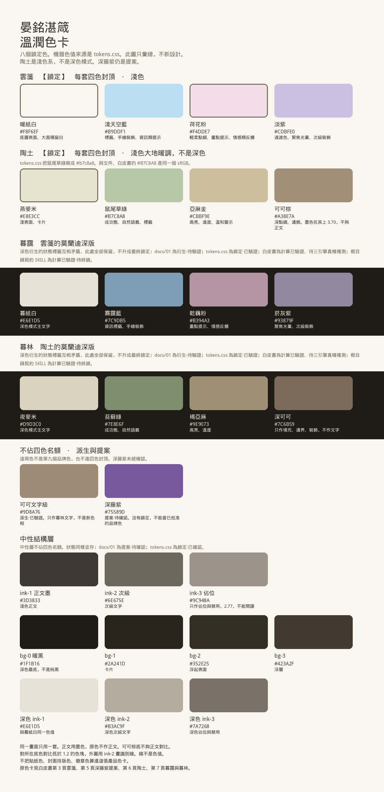
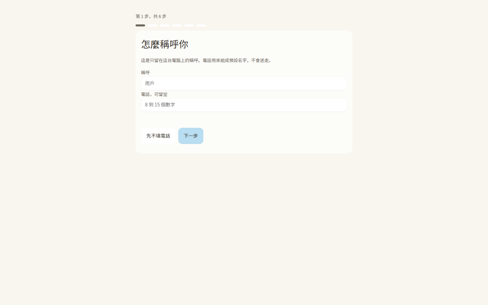
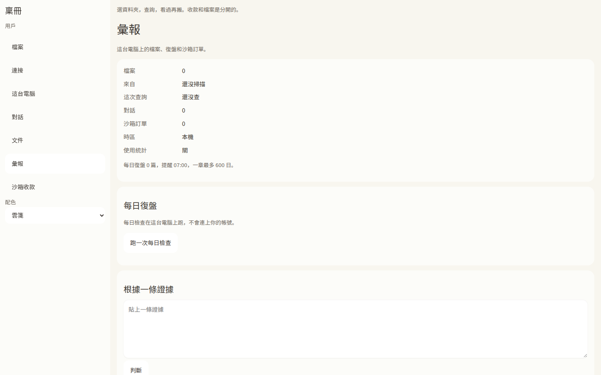
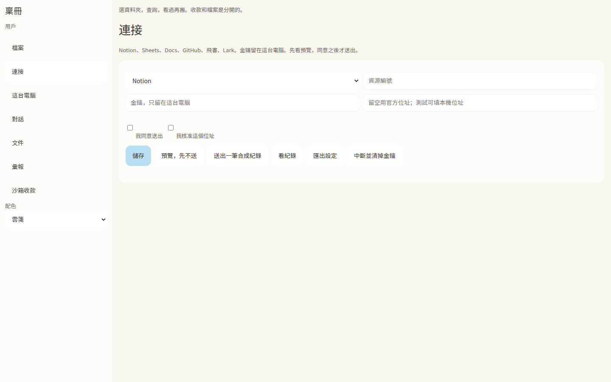
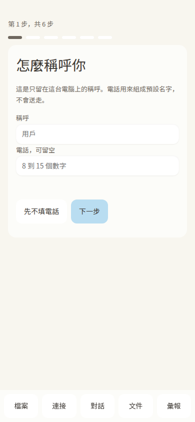

# 晏銘湛箴溫潤設計技能

這是 Ya-MiC 交給支付寶 PAYATHON 2026 **Skill Pay（技能賽道）** 的技能作品。公開賽事頁把 Skill Pay 寫成：為 AI 技能接收款，交付形態是 Skill。這個儲存庫交付的就是那份 Skill：已核准的稟冊 v0.21 外觀，做成一套能裝進代理的視覺文法。它涵蓋簡報 PPTX、文件 DOCX、試算表 XLSX，以及軟體的 UI / UX、前端 Frontend，和支撐這些體驗的後端 Backend 契約。

本包沒有接入收款，也沒有代替報名。色不另造。八個鎖定色與稟冊 `app/ui/tokens.css` 逐字節相同。

技能入口：[`SKILL.md`](SKILL.md)

## 給代理

這個儲存庫的根目錄就是技能。Cursor 讀 `.cursor/skills/ymzz-wenrun-design`，該連結指向根目錄。

其他代理：把這個儲存庫放到技能目錄，目錄名用 `ymzz-wenrun-design`，先讀 `SKILL.md`。

使用順序：

1. 讀 [`SKILL.md`](SKILL.md)。觸發條件寫在開頭。
2. 選色前讀 [`assets/tokens/tokens.css`](assets/tokens/tokens.css)。不要新增色值。
3. 做網頁、桌面或手機時，讀 [`references/product-playbook.md`](references/product-playbook.md) 和 [`references/product-recipes.md`](references/product-recipes.md)。
4. 做前端實作時讀 [`references/frontend.md`](references/frontend.md)。做錯誤、進度、取消、校驗時讀 [`references/backend-contracts.md`](references/backend-contracts.md)。
5. 做 Word、PowerPoint、Excel 時讀 [`references/office-derivations.md`](references/office-derivations.md)，並對照 [`samples/`](samples/README.md)。

乾淨環境先裝測試依賴，再跑測試：`python3 -m pip install -r requirements-dev.txt`，然後 `python3 -m unittest discover -s tests -v`。Pillow 只給測試用。

## 用在哪裡

| 表面 | 做什麼 | 文件 |
|---|---|---|
| UI / UX，網頁、桌面、手機 | 稱呼第一屏、側欄、表單、空與錯誤、載入與恢復 | [`references/product-recipes.md`](references/product-recipes.md) |
| Frontend | token、主題、焦點、對比、減少動態、在地化 | [`references/frontend.md`](references/frontend.md) |
| Backend | 穩定錯誤碼、校驗、進度、取消、隱私。不是把伺服器塗成品牌色 | [`references/backend-contracts.md`](references/backend-contracts.md) |
| Word DOCX、PowerPoint PPTX、Excel XLSX | 同一套色與字級。原始包沒有寫這三種格式，所以這部分標成推導 | [`references/office-derivations.md`](references/office-derivations.md) |

做法對照的是公開產品 T3 Code 與 Nowledge Mem，說明在做法那一章。請求裡的「newnodge mem」對應的是 Nowledge Mem。

## 色卡

八個鎖定色都在這張卡上。暖紙白與紙面同色，所以外圍用 ink-2 畫了識別線；線不是色值。深藤紫標成提案，沒有鎖定。陶土是淺色，不是深色模式。

- 向量檔：[`assets/color-card.svg`](assets/color-card.svg)
- 機器色值：[`assets/tokens/tokens.css`](assets/tokens/tokens.css)
- 稟冊版面：[`assets/product/bingce-app.css`](assets/product/bingce-app.css)

原色卡在《色卡白皮書》v5。下面是原頁，用來對色。第 5 頁是提案。

| 頁 | 內容 | 原頁 |
|---|---|---|
| 3 | 雲箋，鎖定 | [白皮書第 3 頁](assets/original/whitepaper-page-cloud.png) |
| 5 | 深藤紫，提案，未鎖定 | [白皮書第 5 頁](assets/original/whitepaper-page-violet-proposal.png) |
| 6 | 陶土，鎖定，淺色 | [白皮書第 6 頁](assets/original/whitepaper-page-earth.png) |
| 7 | 暮靄與暮林 | [白皮書第 7 頁](assets/original/whitepaper-page-dusk-wood.png) |

## 八個鎖定色

| 色系 | 名稱 | Hex |
|---|---|---|
| 雲箋 | 暖紙白 | `#F8F6EF` |
| 雲箋 | 淺天空藍 | `#B9DDF1` |
| 雲箋 | 荷花粉 | `#F4DDE7` |
| 雲箋 | 淡紫 | `#CDBFE0` |
| 陶土 | 燕麥米 | `#E8E3CC` |
| 陶土 | 鼠尾草綠 | `#B7C8A8` |
| 陶土 | 亞麻金 | `#CBBF9E` |
| 陶土 | 可可棕 | `#A38E7A` |

`tokens.css` 把鼠尾草綠寫成 `#b7c8a8`，與 `#B7C8A8` 是同一個 sRGB。

## 稟冊畫面

截圖來自稟冊 v0.21 的真實頁面，提交 `4d59b866`。桌面 1440×900，手機 390×844。

手機上的側欄會占滿第一屏，再捲動時蓋住內容。那是 v0.21 的版面，做法裡寫明不要抄。見 [`references/product-recipes.md`](references/product-recipes.md)。

## 樣本

| 檔 | 說明 |
|---|---|
| [yunjian-brief.pptx](samples/yunjian-brief.pptx) | 三頁雲箋簡報 |
| [yunjian-brief.docx](samples/yunjian-brief.docx) | 一頁說明與四色表 |
| [yunjian-brief.xlsx](samples/yunjian-brief.xlsx) | 色票與間距，表頭凍結 |

## 還沒有升格的事

深色衍生與中性層的狀態標籤互相矛盾。docs/01 寫待驗證、待確認；tokens.css 寫已鎖定；白皮書寫計算已驗證、還要三引擎真機；契約寫待終鎖。這些標籤全部保留。

暮林在 bg-1、bg-2 上的對比數字，白皮書與 contrast-matrix 不一致。[`references/contrast-check.md`](references/contrast-check.md) 並列兩邊，不指定優勝者。

字級以 token 為準：`Noto Sans SC Variable`，正文 14px，行高 1.7，數字 tabular-nums，深色字重 −40。行動長文 token 是 15px。

不收進產品色卡的東西：貼紙預設、封面金色、徽章用色、Ludi 私人研讀語料。原始包裡沒有 `tokens.json`、`tokens.light.json`、`scripts/color_math.py`、`scripts/contrast_verify.py`。

出處：[`references/provenance.md`](references/provenance.md)。第三方：[`THIRD-PARTY.md`](THIRD-PARTY.md)。

## 授權

[MIT](LICENSE)。這份授權不改寫 OFL 字型、圖示，或被排除的第三方文字。儲存庫裡沒有字型檔。

## English

This repository is Ya-MiC's Skill entry for Alipay PAYATHON 2026, Skill Pay. Public event pages describe Skill Pay as the track where the deliverable is a Skill. The skill here is the approved 稟冊 v0.21 look, packaged so an agent can apply one grammar to UI / UX, Frontend, the Backend contracts that support that UX, and editable PPTX, DOCX, and XLSX.

This package does not connect a checkout and does not submit the entry. The eight locked colors are byte-identical to 稟冊 `app/ui/tokens.css`.

Skill entry: [`SKILL.md`](SKILL.md)

### For agents

The repository root is the skill. `.cursor/skills/ymzz-wenrun-design` points at that root. For another agent, place the repository in the skills directory under the name `ymzz-wenrun-design` and read `SKILL.md` first.

1. Read [`SKILL.md`](SKILL.md).
2. Read [`assets/tokens/tokens.css`](assets/tokens/tokens.css) before choosing a color.
3. For a page, read [`references/product-playbook.md`](references/product-playbook.md) and [`references/product-recipes.md`](references/product-recipes.md).
4. For implementation, read [`references/frontend.md`](references/frontend.md). For errors, progress, cancel, and validation, read [`references/backend-contracts.md`](references/backend-contracts.md).
5. For Word, PowerPoint, and Excel, read [`references/office-derivations.md`](references/office-derivations.md) and the files in [`samples/`](samples/README.md).

On a clean checkout, install the test dependency first, then run the tests: `python3 -m pip install -r requirements-dev.txt`, then `python3 -m unittest discover -s tests -v`. Pillow is test-only.

### Where it applies

| Surface | What it governs | Document |
|---|---|---|
| UI / UX on web, desktop, and mobile | Nickname first, sidebar, forms, empty and error, loading and recovery | [`references/product-recipes.md`](references/product-recipes.md) |
| Frontend | Tokens, theme, focus, contrast, reduced motion, locale | [`references/frontend.md`](references/frontend.md) |
| Backend | Stable error codes, validation, progress, cancel, privacy. Not a coat of brand color on the server | [`references/backend-contracts.md`](references/backend-contracts.md) |
| Word DOCX, PowerPoint PPTX, Excel XLSX | The same color and type. The archive never names these formats, so the mapping is derived | [`references/office-derivations.md`](references/office-derivations.md) |

The product bar is benchmarked against the public products T3 Code and Nowledge Mem. The phrase "newnodge mem" matches Nowledge Mem.

### Color card

All eight locked colors are on this card. 暖紙白 matches the page, so an ink-2 keyline is drawn around chips whose contrast against the page is under 1.2. The keyline is not a color. 深藤紫 is a proposal. 陶土 is a light family, not a dark theme.

Machine values: [`assets/tokens/tokens.css`](assets/tokens/tokens.css). 稟冊 chrome: [`assets/product/bingce-app.css`](assets/product/bingce-app.css).

| Family | Name | Hex |
|---|---|---|
| 雲箋 | 暖紙白 | `#F8F6EF` |
| 雲箋 | 淺天空藍 | `#B9DDF1` |
| 雲箋 | 荷花粉 | `#F4DDE7` |
| 雲箋 | 淡紫 | `#CDBFE0` |
| 陶土 | 燕麥米 | `#E8E3CC` |
| 陶土 | 鼠尾草綠 | `#B7C8A8` |
| 陶土 | 亞麻金 | `#CBBF9E` |
| 陶土 | 可可棕 | `#A38E7A` |

### Screens and samples

The screenshots are the real 稟冊 v0.21 UI at commit `4d59b866`, desktop 1440×900 and mobile 390×844. See [`references/product-recipes.md`](references/product-recipes.md). Generated files: [PPTX](samples/yunjian-brief.pptx), [DOCX](samples/yunjian-brief.docx), [XLSX](samples/yunjian-brief.xlsx).

### What stays unpromoted

Status labels for the dark derivatives and the neutrals contradict each other. docs/01 says pending verification or confirmation. `tokens.css` says locked. The whitepaper says the math is checked and a three-engine device pass is still required. The root contract says pending final lock. All of those labels stay.

暮林 contrast ratios on bg-1 and bg-2 differ between the whitepaper and `contrast-matrix.md`. [`references/contrast-check.md`](references/contrast-check.md) cites both and does not choose a winner.

Type follows the token: `Noto Sans SC Variable`, 14px body, 1.7 line-height, tabular numbers, dark-mode weight −40. The mobile long-form token is 15px.

The product card excludes the sticker preset, the cover gold, emblem colors, and the private Ludi study corpus. The archive had no `tokens.json`, no `tokens.light.json`, no `scripts/color_math.py`, and no `scripts/contrast_verify.py`.

Provenance: [`references/provenance.md`](references/provenance.md). Third-party limits: [`THIRD-PARTY.md`](THIRD-PARTY.md).

### License

[MIT](LICENSE) for this skill. That grant does not relicense OFL fonts, icon sets, or excluded third-party text. No font binaries are in this repository.
