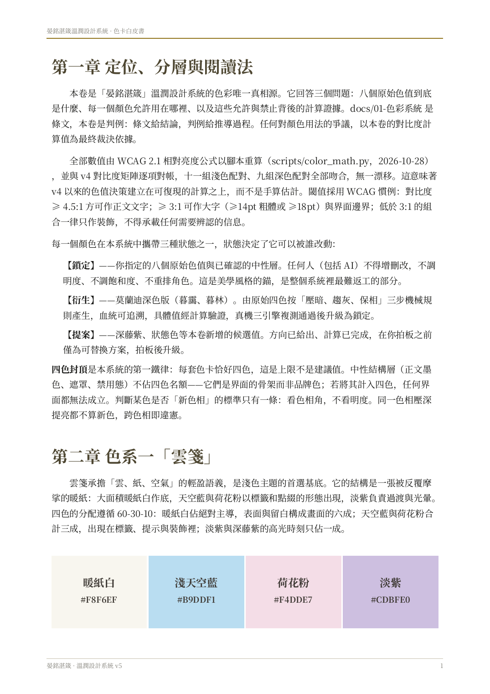
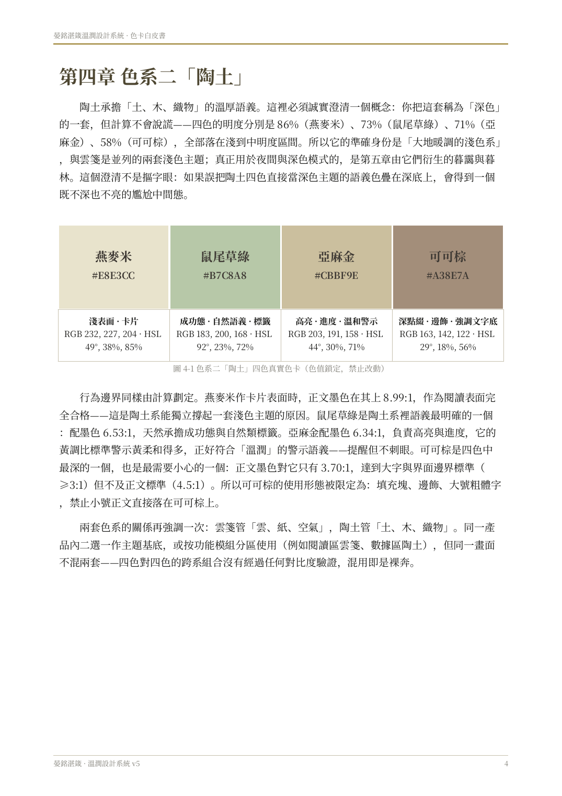
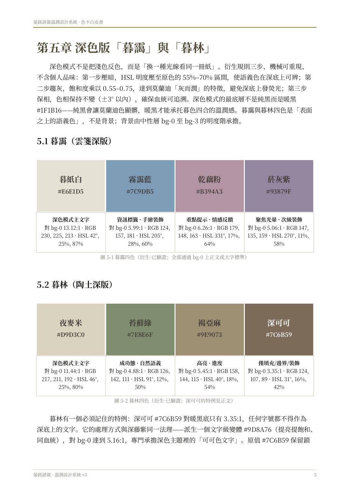
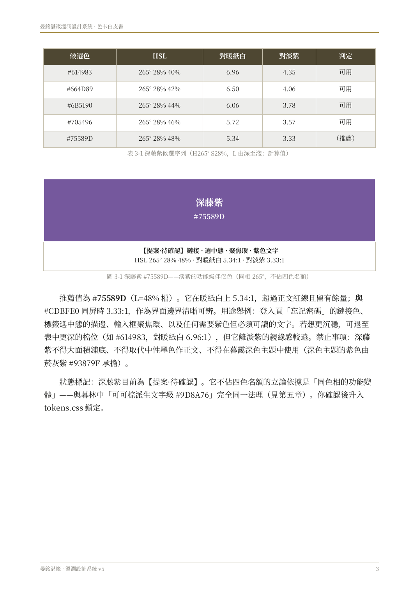

# 晏銘湛箴 / ymzz wenrun design skill

溫潤設計技能。把網站那套視覺文法用到網頁，並在需要時用到可編輯的 PPTX、DOCX、XLSX。色值來自 wenrun-design-system v7.1，不另造一套辦公室配色。

Wenrun design skill. It applies the website visual grammar to the web and, when needed, to editable PPTX, DOCX, and XLSX. The colors come from wenrun-design-system v7.1. Office files do not get a second palette.

技能入口 / Skill entry: [`SKILL.md`](SKILL.md)

## 用在哪裡 / Where it applies

同一套溫潤文法，不是只有簡報，也不是只有一份色卡 PDF。

| 表面 | 做什麼 | 文件 |
|---|---|---|
| UI / UX，網頁、桌面、手機 | 層級、表單、導航、表格、圖表、載入、空、錯誤、恢復、鍵盤與觸控 | [`references/interaction-and-states.md`](references/interaction-and-states.md) |
| 前端 Frontend | token、主題、焦點、對比、減少動態、在地化 | [`references/frontend.md`](references/frontend.md) |
| 後端 Backend | 穩定錯誤碼、校驗、進度、取消、隱私。不是把伺服器塗成品牌色 | [`references/backend-contracts.md`](references/backend-contracts.md) |
| Word DOCX、PowerPoint PPTX、Excel XLSX | 同一套色與字級。原始包沒有寫這三種格式，所以這部分標成推導 | [`references/office-derivations.md`](references/office-derivations.md) |

The same wenrun grammar covers the product, not only slides and not only the palette PDF.

| Surface | What it governs | Document |
|---|---|---|
| UI / UX on web, desktop, and mobile | Hierarchy, forms, navigation, tables, charts, loading, empty, error, recovery, keyboard and touch | [`references/interaction-and-states.md`](references/interaction-and-states.md) |
| Frontend | Tokens, theme, focus, contrast, reduced motion, locale | [`references/frontend.md`](references/frontend.md) |
| Backend | Stable error codes, validation, progress, cancel, privacy. Not a coat of brand color on the server | [`references/backend-contracts.md`](references/backend-contracts.md) |
| Word DOCX, PowerPoint PPTX, Excel XLSX | The same color and type. The archive never names these formats, so the mapping is derived | [`references/office-derivations.md`](references/office-derivations.md) |

後端 JSON 形狀若原始包沒有定義，就標成推導，並由 [`scripts/ux_contract.py`](scripts/ux_contract.py) 檢查。原始包沒有分頁格式、時區格式、重試次數或保留天數。

Derived JSON is checked by [`scripts/ux_contract.py`](scripts/ux_contract.py). The archive does not define pagination, timezone, a retry count, or a retention period.

## 色卡 / Color card

八個鎖定色都在這張卡上。暖紙白與紙面同色，所以外圍用 ink-2 畫了識別線；線不是色值。深藤紫標成提案，沒有鎖定。陶土是淺色，不是深色模式。

All eight locked colors are on this card. 暖紙白 matches the page, so an ink-2 keyline is drawn around chips whose contrast against the page is under 1.2. The keyline is not a color. 深藤紫 is marked as a proposal. 陶土 is a light family, not a dark theme.

- 向量檔 / Vector: [`assets/color-card.svg`](assets/color-card.svg)
- 機器色值 / Machine values: [`assets/tokens/tokens.css`](assets/tokens/tokens.css)
- 派生索引，不是原始檔 / Derived index, not an original file: [`assets/tokens/index.derived.json`](assets/tokens/index.derived.json)

### 白皮書原頁 / Original whitepaper pages

原色卡在《色卡白皮書》v5。下面四頁是原頁渲染，用來對色，不是新設計。第 5 頁是提案。

The original swatches are in the v5 whitepaper. These four renders are for comparison. Page 5 is the unconfirmed proposal.

| 頁 | 內容 | 原頁 |
|---|---|---|
| 3 | 雲箋，鎖定 | [whitepaper page 3](assets/original/whitepaper-page-cloud.png) |
| 5 | 深藤紫，提案，未鎖定 | [whitepaper page 5](assets/original/whitepaper-page-violet-proposal.png) |
| 6 | 陶土，鎖定，淺色 | [whitepaper page 6](assets/original/whitepaper-page-earth.png) |
| 7 | 暮靄與暮林 | [whitepaper page 7](assets/original/whitepaper-page-dusk-wood.png) |

全文 / Full paper: [`assets/original/color-whitepaper-v5.pdf`](assets/original/color-whitepaper-v5.pdf)

## 八個鎖定色 / Eight locked colors

| 色系 | 名稱 | Hex |
|---|---|---|
| 雲箋 | 暖紙白 | `#F8F6EF` |
| 雲箋 | 淺天空藍 | `#B9DDF1` |
| 雲箋 | 荷花粉 | `#F4DDE7` |
| 雲箋 | 淡紫 | `#CDBFE0` |
| 陶土 | 燕麥米 | `#E8E3CC` |
| 陶土 | 鼠尾草綠 | `#B7C8A8` |
| 陶土 | 亞麻金 | `#CBBF9E` |
| 陶土 | 可可棕 | `#A38E7A` |

`tokens.css` 把鼠尾草綠寫成 `#b7c8a8`，與 `#B7C8A8` 是同一個 sRGB。

## 中文

這份技能把溫潤文法寫成可以重複使用的規則：四色封頂、正文只用墨色、同一畫面不混兩套、間距與字級走 token。網頁直接消費 [`tokens.css`](assets/tokens/tokens.css)。投影片、文件、試算表的對應寫在 [`references/office-derivations.md`](references/office-derivations.md)，並標明是推導。v7.1 原始包從來沒有寫 PPTX、DOCX、XLSX。

深色衍生與中性層的狀態標籤互相矛盾。docs/01 寫待驗證、待確認；tokens.css 寫已鎖定；白皮書寫計算已驗證、還要三引擎真機；契約 SKILL 寫待終鎖。這些標籤全部保留，沒有把暫定值升成已批准。

暮林在 bg-1、bg-2 上的對比數字，白皮書與 contrast-matrix 不一致。[`references/contrast-check.md`](references/contrast-check.md) 把兩邊和重新計算並列，不指定優勝者。

字級以 token 為準：`Noto Sans SC Variable`，正文 14px，行高 1.7，數字 tabular-nums，深色字重 −40。行動長文 token 是 15px。

不收進產品色卡的東西：貼紙預設、封面金色、徽章用色、Ludi 私人研讀語料。原始包裡沒有 `tokens.json`、`tokens.light.json`、`scripts/color_math.py`、`scripts/contrast_verify.py`。

出處表：[`references/provenance.md`](references/provenance.md)。第三方限制：[`THIRD-PARTY.md`](THIRD-PARTY.md)。

## English

The skill is a reusable procedure: four colors in a set, ink for text, one family on a surface, spacing and type from the tokens. Web work consumes [`tokens.css`](assets/tokens/tokens.css). Slides, documents, and workbooks are mapped in [`references/office-derivations.md`](references/office-derivations.md), and that file is marked as a derivation. The v7.1 archive never names PPTX, DOCX, or XLSX.

Status labels for the dark derivatives and the neutrals contradict each other. docs/01 says pending verification or confirmation. `tokens.css` says locked. The whitepaper says the math is checked and a three-engine device pass is still required. The root contract says pending final lock. All of those labels stay. Tentative values are not promoted.

暮林 contrast ratios on bg-1 and bg-2 differ between the whitepaper and `contrast-matrix.md`. [`references/contrast-check.md`](references/contrast-check.md) cites both beside a recomputation and does not choose a winner.

Type follows the token: `Noto Sans SC Variable`, 14px body, 1.7 line-height, tabular numbers, dark-mode weight −40. The mobile long-form token is 15px.

The product card does not include the sticker preset, the cover gold, emblem colors, or the private Ludi study corpus. The archive had no `tokens.json`, no `tokens.light.json`, no `scripts/color_math.py`, and no `scripts/contrast_verify.py`.

Provenance: [`references/provenance.md`](references/provenance.md). Third-party limits: [`THIRD-PARTY.md`](THIRD-PARTY.md).

## License

[MIT](LICENSE) for this skill. That grant does not relicense OFL fonts, icon sets, or excluded third-party text. No font binaries are in this repository.
