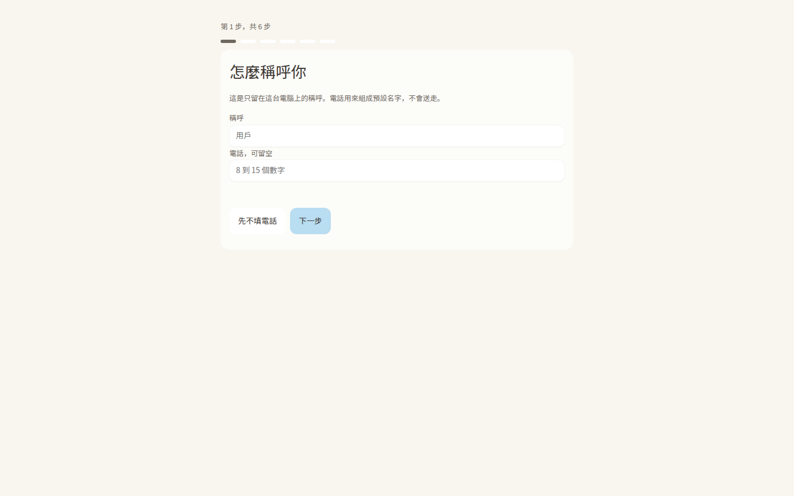
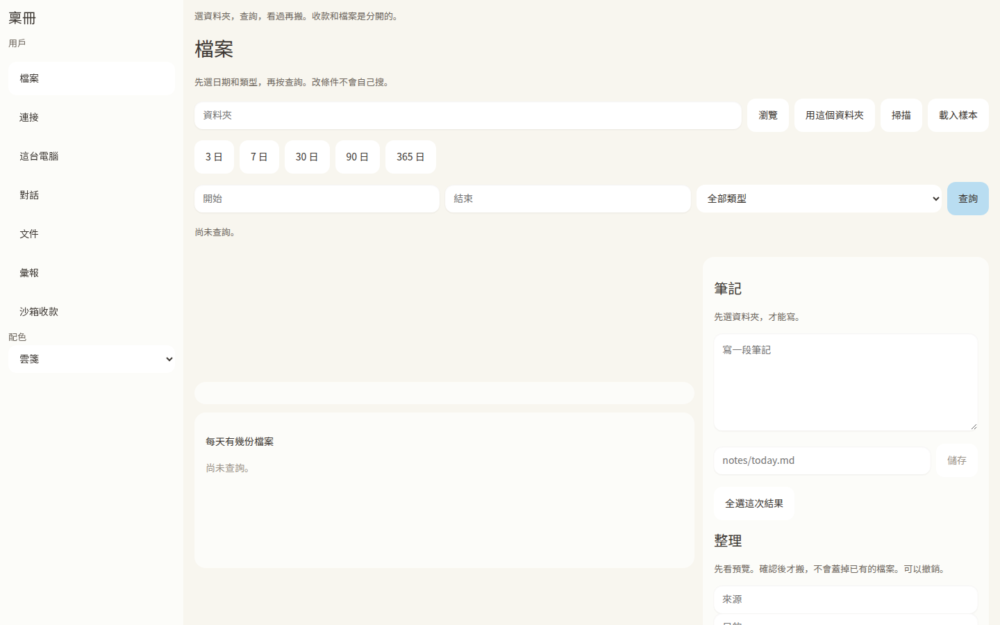
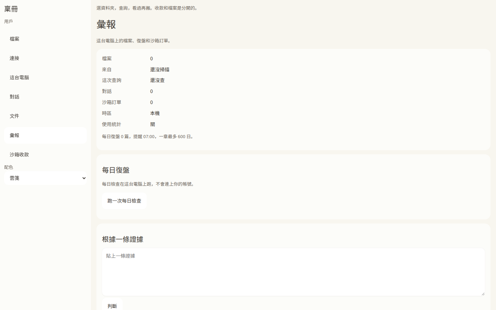
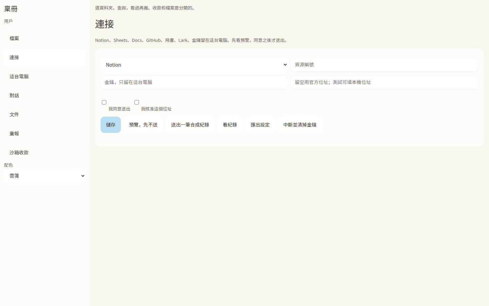
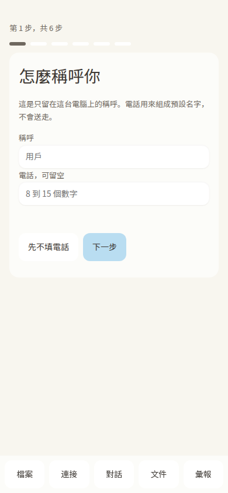
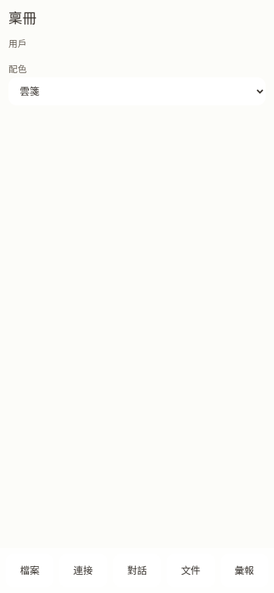
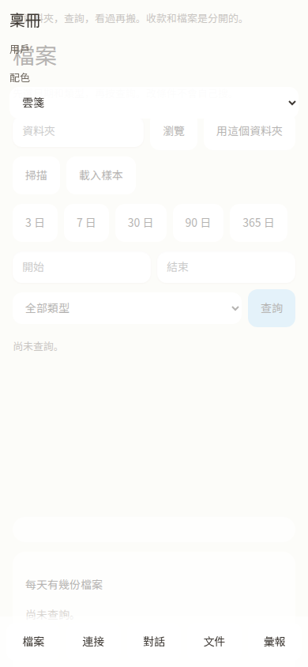

# 頁面與元件做法

畫面來自稟冊 v0.21 的真實頁面，提交 `4d59b866`，分支 `cursor/v021-integrated-app-e023`。截圖時用的是該提交的 `app/ui`（`index.html`、`app.css`、`tokens.css`、`app.js`），由無頭 Chrome 打開。工作階段請求由一個本地替身回答，不是 Rust 核心。彙報上的 0 是頁面自己的空狀態，不是某台電腦的統計。字型在執行時從該目錄讀取，沒有放進這個儲存庫。記錄在 `assets/product/screens/capture.json`。

## 桌面，第一屏

稱呼在卡片裡。進度在卡片外。主按鈕用 `--accent`（雲箋是淺天空藍），字是墨色。

做法：一張卡片，寬度不超過 640px，置中。標題用 `--fs-h2`、字重 500。說明用 `--ink-2`。輸入用 `.input-warm`。不要在這一步放資料夾、金鑰或設定。

## 桌面，檔案

空的時候寫「尚未查詢。」查詢不會在改條件時自己跑。

這頁仍有路徑欄。新產品改成選擇器、拖放、或自動判斷，見 `references/product-playbook.md`。

## 桌面，彙報

側欄點「彙報」之後是定義清單。數字現在不是連結。

新產品把「檔案 0」「對話 0」做成按鈕，點進去就是那一頁。空的句子維持「還沒掃描」「還沒查」。

## 桌面，企業後台

「連接」是後台：選服務、金鑰留在本機、兩次同意、先預覽再送出。主按鈕仍是淺天空藍配墨色字。

## 手機

390×844。底欄在 860px 以下出現。引導頁的底欄在 v0.21 也會出現，因為底欄不在被隱藏的工作區裡。新產品在引導完成前不要畫底欄。

檔案頁的側欄是 `height: 100vh` 而且 sticky。第一屏幾乎只有品牌和配色。

再往下捲，內容會鑽到側欄下面。這是 v0.21 的版面，不是要保留的規則。

手機做法：底欄換頁。側欄不要用 100vh sticky。標題和主按鈕留在第一屏。命中不小於 `--hit`（48px）。長文用 `--fs-body-mobile`（15px）。

## 元件

| 元件 | 稟冊的類名 | 值 |
|---|---|---|
| 頁面底 | `body` | `--bg-0` |
| 側欄 | `.side` | `--bg-1`，寬 `--side-w` |
| 卡片 | `.card` | 圓角 16px，內距 `--pad-card` |
| 主按鈕 | `button.primary` | 底 `--accent`，字 `--ink-1`，圓角 12px，高 `--hit` |
| 輸入 | `.input-warm` | 內陰影，圓角 12px |
| 橫幅 | `.banner` | `--accent-soft`，圓角 12px |
| 目前頁 | `[aria-current="page"]` | 底 `--bg-3` |
| 空狀態 | `.quiet` | `--ink-2`，`--fs-secondary` |
| 停用 | `button:disabled` | `--ink-3` |

焦點用 token 的 `:focus-visible`。不要拿掉外框。輸入框那條寫死的淡紫光暈不要再複製；改消費 `--focus-halo`。

## 投影片、文件、試算表

同一套雲箋，推導樣本在 `samples/`。頁面做法見 `references/office-derivations.md`。

## 前端與後端

前端消費 token 的方式見 `references/frontend.md`。錯誤、進度、取消、校驗見 `references/backend-contracts.md`。後端不是一層伺服器專用的顏色。

## English

The screenshots are the real 稟冊 v0.21 page at commit `4d59b866`, opened in headless Chrome. A local stand-in answered session calls. It is not the Rust core. Report figures are the page's own empty state. The phone shots show two defects to avoid: the dock is visible during onboarding, and the sticky `100vh` sidebar covers the work. New layouts keep the dock for navigation, hide it until onboarding is done, and keep the title and primary button on the first screen.
